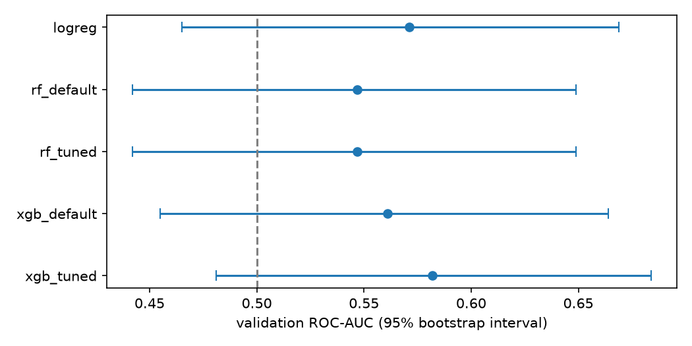

# Classical ML Results (Week 3)

Comparison of classical models for next-day direction of BBCA.JK, using the train and validation sets only. The test set has not been touched; see [Selection protocol](#selection-protocol) for how and when it will be used.

## Setup

- Data and features: BBCA.JK daily OHLCV, 12 technical features (see [architecture.md](architecture.md)); label = next-day direction (`horizon=1`)
- Split: chronological 70 / 15 / 15 (train / validation / test); test untouched
- Primary metric: ROC-AUC (threshold-free); accuracy, precision, recall and F1 are reported for context
- Cross-validation on train: `TimeSeriesSplit(n_splits=5, gap=1)`
- Models:

| Name | Description | Parameters from |
|---|---|---|
| dummy | Always predicts the majority class (reference only, not a candidate) | n/a |
| logreg | Standardized features + logistic regression | defaults |
| rf_default / rf_tuned | Random Forest | Day 14 / Day 16 (grid search) |
| xgb_default / xgb_tuned | XGBoost | Day 14 / Day 16 (Optuna, 40 trials) |

## Selection protocol

Written on Day 18, before the paired bootstrap analysis was run and before the test set was touched.

Honest note: validation ROC-AUC of every model had already been seen during Days 14-17, so the validation set is not blind. The purpose of this protocol is to keep the **test set** blind and to stop the final choice from being driven by noise in a ~130-row validation set.

1. **Candidates, simplest first:** `logreg`, `rf_default`, `rf_tuned`, `xgb_default`, `xgb_tuned`. The dummy is a reference, not a candidate.
2. **Incumbent:** starts as `logreg`.
3. **Challenges:** each later candidate, in the order above, challenges the current incumbent. The challenger replaces the incumbent only if the lower end of the 95% paired bootstrap interval of `AUC(challenger) - AUC(incumbent)` on the validation set is above 0 (2000 resamples, seed 42, `paired_bootstrap_auc_diff`).
4. **Default outcome:** if no challenger clears that bar, the simpler model stays. A more complex model needs evidence, not just a higher point estimate.
5. **Chance check (reported, not a gate):** whether the 95% bootstrap interval of the selected model's validation ROC-AUC excludes 0.5. A model is carried into Week 4 either way, but the conclusions must say whether skill has actually been demonstrated.
6. **No edits after results:** the rule is not changed after the results are known. If it proves badly specified, a dated note is added under Limitations instead of editing this section.
7. **Test set:** the selected model is refit on train + validation with unchanged hyperparameters and evaluated on the test set **exactly once, on Day 24**, together with the backtest. The dummy and `logreg` are reported alongside as references only. The selection is not revisited after the test result is known.

Known weaknesses of the procedure: the bootstrap resamples rows independently and ignores time dependence (a rough approximation for daily direction labels), and four challenges are run at 95% each, so the overall false-promotion rate is higher than 5%.

## Validation results

TODO: paste the table from `results/day18_comparison.csv` (printed as Markdown at the end of the notebook).

## What the earlier experiments showed

- **Tuning (Day 16):** TODO: how much did CV ROC-AUC improve over the defaults, how wide was the spread of the 40 Optuna trials, and did the improvement carry over to validation?
- **Feature importance (Day 15):** TODO: one or two sentences; details in [feature_importance.md](feature_importance.md)
- **Class imbalance (Day 17):** TODO: how lopsided were the classes, and what did class weights and threshold shifting change (and not change)?

## Decision

- **Selected model:** TODO
- **Evidence:** TODO (paired intervals from `results/day18_selection_log.csv`)
- **Chance check:** TODO (does the validation AUC interval exclude 0.5?)

## Test set result

Not evaluated yet. Planned for Day 24 (see Selection protocol, step 7).

## Limitations

- One ticker (BBCA.JK) and roughly 130 validation rows: validation ROC-AUC has a 95% interval of about ±0.10, so small differences between models are not meaningful
- The validation set was viewed repeatedly while tuning and comparing, so it is not a fully independent estimate
- Bootstrap intervals ignore time dependence between rows
- Metrics here ignore trading costs and position sizing; that is Week 4

## Next steps

- Week 4: backtest the selected model's signals, developed on train and validation only
- Day 24: single test-set evaluation under the protocol above
- Feature ideas from Day 15: replace price-level features with ratios, and revisit multi-ticker training in Week 6
